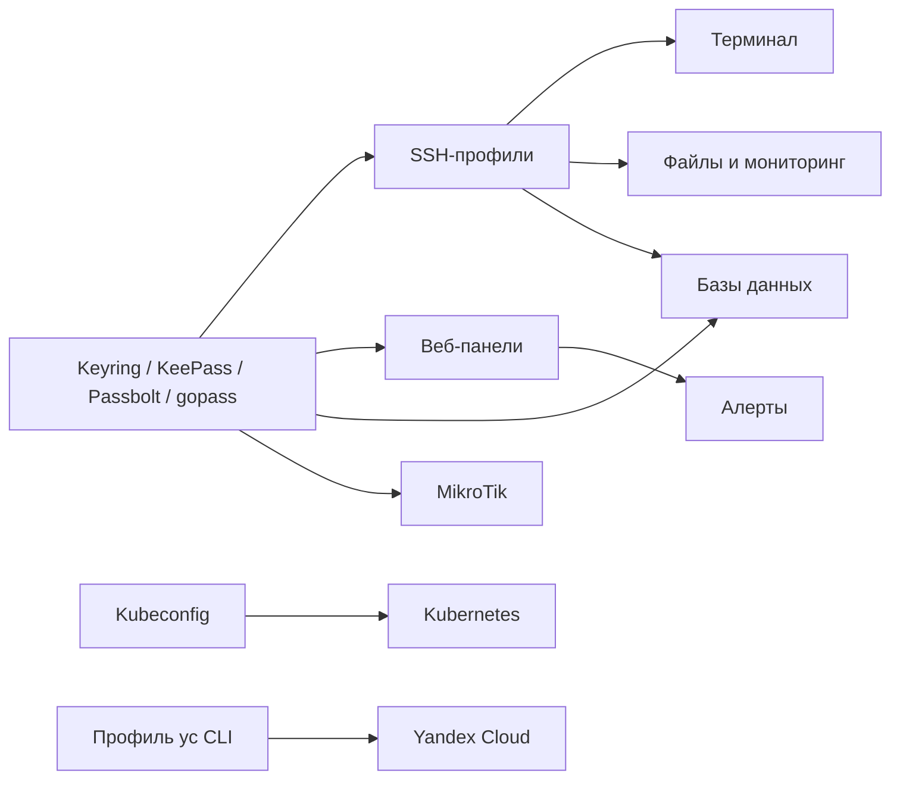

# Wiki OpsDeck

Практическое руководство для версии 0.9.1. OpsDeck — локальное настольное приложение: источники и серверы добавляются в соответствующих разделах, а кнопка **!** в каждом разделе открывает встроенную подсказку.

## С чего начать

1. [Установка и первый запуск](getting-started.md) — требования, установка, модули и окружения.
2. [Подключения](connections.md) — SSH, Kubernetes, веб-панели и алерты, базы, Yandex Cloud, MikroTik, хранилища паролей.
3. [Работа в OpsDeck](usage.md) — терминал, AI, IDE, заметки, мониторинг и перенос настроек.
4. [Локальный ИИ и OpenCode](ai.md) — встроенная модель, внешний сервер и JSON-конфигурация OpenCode.

## Как связаны разделы

Разделы включаются кнопкой **⊞** в левой колонке. При новой установке включены Терминал, Kubernetes, SSH, KeePass и Заметки. Открывать все разделы сразу необязательно.

Дополнительно: [обзор возможностей и сборка из исходников](../../README.md), [сообщить о проблеме](https://github.com/LeoAlecksey/opsdeck/issues).
